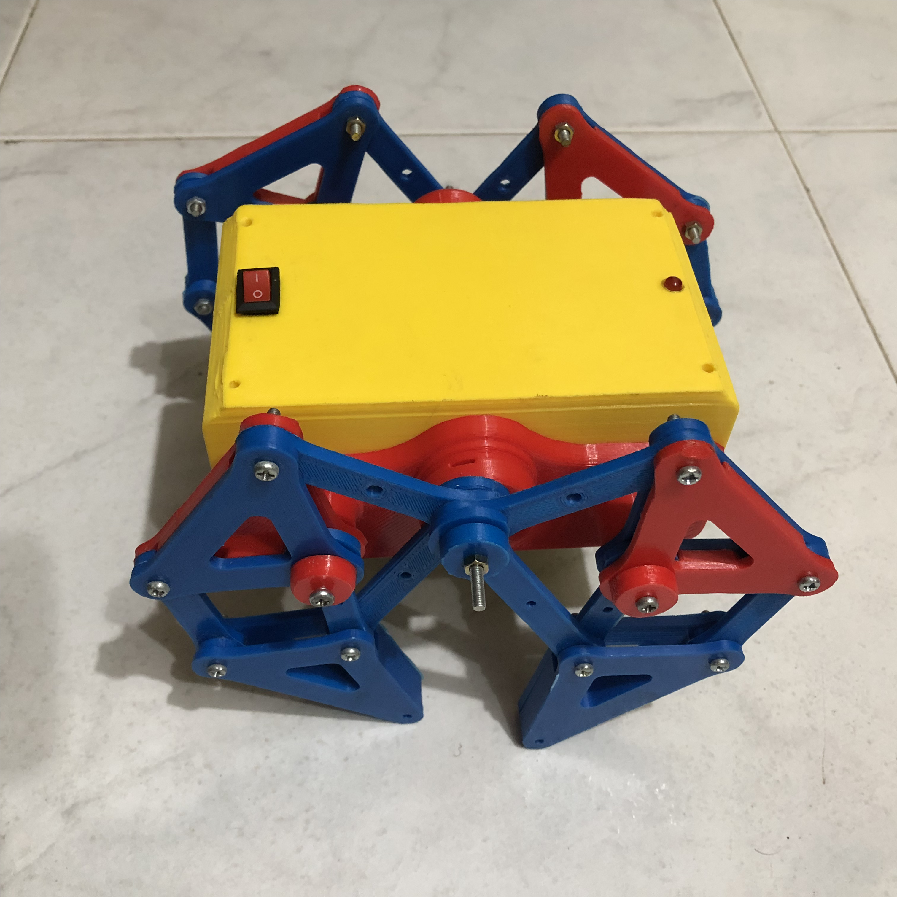

# PATITAS: Araña mecánica

  

  

Prototipo robótico educativo desarrollado como parte del proyecto de grado en modalidad de pasantía **“Desarrollo de prototipos robóticos para la enseñanza en Nariño”**, realizado en la **Subsecretaría de Innovación**.

Este repositorio reúne los recursos didácticos y la documentación relacionados con el prototipo PATITAS: cartilla, tutorial de construcción, listado de componentes y material complementario para apoyar su implementación en espacios educativos.

## Sobre el prototipo

PATITAS es una araña mecánica educativa cuyo mecanismo permite explorar conceptos básicos de robótica, movimiento y sistemas electromecánicos mediante el montaje y la interacción con un prototipo físico.

## Recursos

### Cartilla
Guía didáctica para conocer los componentes, el circuito y el proceso de montaje del prototipo.

*Próximamente: enlace al archivo PDF.*

### Tutorial de construcción

Haz clic en la imagen para ver el video en YouTube:

  

  <a href="https://www.youtube.com/watch?v=Rccqas9SQrU">
    <strong>▶ Ver tutorial en YouTube</strong>
  </a>

### Componentes y material complementario

- **Componentes:** relación de materiales y elementos utilizados.
- **Fotografías:** imágenes del prototipo y sus componentes disponibles en la carpeta `imagenes/`.
- **Otros recursos:** materiales de apoyo que se incorporarán posteriormente.

## Créditos y atribución del diseño

El mecanismo de este prototipo está basado en el modelo **“Strandbeest – 4 extremidades”**, diseñado originalmente por **RoboLacyTech** y publicado en Cults3D:

[Consultar el modelo original en Cults3D](https://cults3d.com/es/modelo-3d/artilugios/strandbeest-4-extremidades)

La difusión de fotografías, renders, animaciones, videos y material didáctico asociado al prototipo se realiza con autorización del autor para fines educativos, conservando el reconocimiento correspondiente y el enlace al diseño original. Los archivos de las piezas del modelo original o sus adaptaciones no se redistribuyen desde este repositorio, y el material no se destina a usos comerciales.

## Proyecto de grado

**Título:** Desarrollo de prototipos robóticos para la enseñanza en Nariño  
**Modalidad:** Pasantía  
**Entidad:** Subsecretaría de Innovación

---

Este repositorio tiene fines académicos y educativos. Se reconoce la autoría del diseño original en los términos indicados anteriormente.
