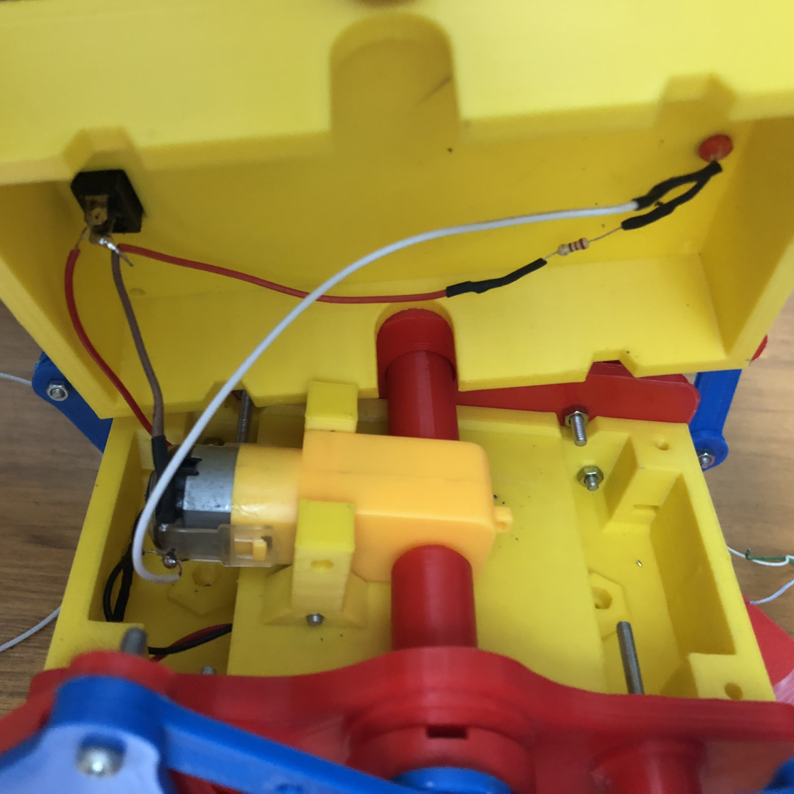

# PATITAS: Araña mecánica

  

  

Prototipo robótico educativo desarrollado como parte del proyecto de grado en modalidad de pasantía **“Desarrollo de prototipos robóticos para la enseñanza en Nariño”**, realizado en la **Subsecretaría de Innovación**.

Este repositorio reúne los recursos didácticos y la documentación relacionados con el prototipo PATITAS, con el propósito de apoyar su construcción y uso en espacios educativos.

## Sobre el prototipo

PATITAS es una araña mecánica educativa cuyo mecanismo permite explorar conceptos básicos de robótica, movimiento y sistemas electromecánicos mediante el montaje y la interacción con un prototipo físico.

## Recursos educativos

### Cartilla de construcción y uso

La cartilla se encuentra dentro de la carpeta **cartilla/**. Para consultarla, ingresa a esa carpeta y selecciona el archivo PDF. Puedes visualizarlo directamente en GitHub o descargarlo a tu dispositivo.

  
  &nbsp;
  

### Tutorial de construcción

Haz clic en la miniatura o en el botón para ver el video en YouTube:

  

  <a href="https://www.youtube.com/watch?v=Rccqas9SQrU">
    <strong>▶ Ver tutorial en YouTube</strong>
  </a>

## Documentación visual

### Listado de componentes

En la siguiente imagen se presenta la relación de los componentes utilizados para el desarrollo del prototipo.

  

### Conexiones internas

Esta fotografía permite observar la disposición de los elementos y las conexiones internas del prototipo.

  

## Créditos y autorización de uso del diseño

El mecanismo de este prototipo está basado en el modelo **“Strandbeest – 4 extremidades”**, diseñado originalmente por **RoboLacyTech** y publicado en Cults3D:

[Consultar el modelo original en Cults3D](https://cults3d.com/es/modelo-3d/artilugios/strandbeest-4-extremidades).

Se cuenta con autorización del autor para compartir fotografías, renders, animaciones, videos y material didáctico asociado al prototipo con fines educativos, conservando el reconocimiento correspondiente y el enlace al diseño original. Los archivos de las piezas del modelo original o sus adaptaciones no se redistribuyen desde este repositorio, y el material no se destina a usos comerciales.

## Proyecto de grado

**Título:** Desarrollo de prototipos robóticos para la enseñanza en Nariño  
**Modalidad:** Pasantía  
**Entidad:** Subsecretaría de Innovación

---

Este repositorio tiene fines académicos y educativos. Se reconoce la autoría del diseño original en los términos indicados anteriormente.
